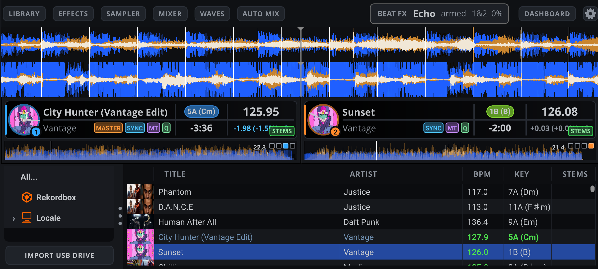
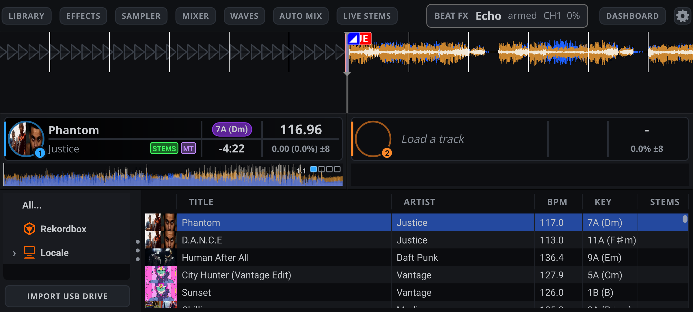
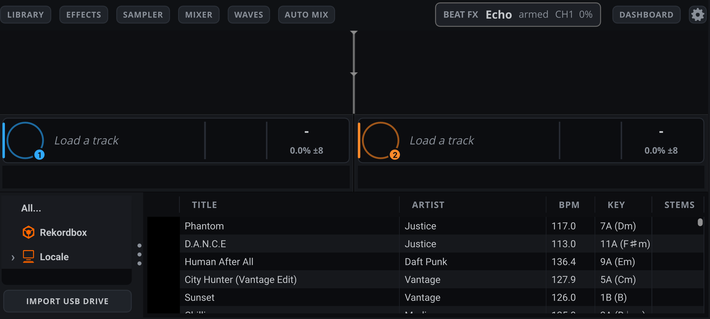

# Ubøros DJ

A touch-first DJ app for Android phones, built on an open-source DJ engine and its QML interface (see [NOTICE.md](NOTICE.md)),
designed around a 2-channel USB DJ controller and USB drives prepared with common DJ software, with a club-player-style deck display.

> **Status: early / personal project.** This repository currently holds the documentation only.
> The source code is not published yet; it will be released under the GPL (see [License](#license)) once it has been cleaned up.
> Everything described below runs on the author's phone (Xiaomi Mi 11 Ultra, Android 14+ target) but has not been tested widely.

## Screenshots

Landscape phone layout, two decks, three-band waveforms, library with harmonic keys and harmonic highlighting:

One deck loaded, stems available (`STEMS` badge, `LIVE STEMS` button), effect status in the toolbar:

Empty decks and the library with the USB-drive and local sources:

## What is different from the upstream engine

About 140 commits on top of the upstream `main` branch (Nov 2026), roughly 16,000 lines added. Full list in
[docs/IMPROVEMENTS.md](docs/IMPROVEMENTS.md). Highlights:

- **Android MIDI backend** (NDK AMidi, hot-plug) with automatic mapping selection; the author's controller works, incl. LEDs, browse knob, performance pads and the filter/stem knob.
- **Phone UI** in QML: compact layout, touch track list, club-player-style deck bar (BPM, pitch delta, remaining time, harmonic key, sync/master/key-lock/loop indicators, beat counter), full-track overview under each deck, dashboard view.
- **DJ USB drives**: read the drive's export database, with or without root (USB host import), and keep the analyses on the drive in a separate folder so the drive stays compatible with club players.
- **Stems on the phone**: 3-stem playback (drums, bass + melody, vocals), on-device separation (htdemucs / Spleeter, MNN + OpenCL), cached on disk, driven by the filter knob.
- **Performance work** for phones: 60 Hz render, GPU-drawn waveforms, one analysis thread, background work at batch priority, SQLite WAL, thumbnail covers, fewer allocations in the audio path.
- **Library intelligence**: harmonic-key and BPM-proximity highlighting, automatic analysis of tracks without BPM, suspicious BPM marked in yellow, half/double-tempo reconciliation with the file tag.
- **Safety nets**: loaded tracks saved when the app goes to the background, OLED burn-in protection, screen off when idle.

## Roadmap

See [docs/ROADMAP.md](docs/ROADMAP.md): GPU stem separation, tests on more phones and Android 14, USB import without root on all drives,
further optimizations, grid auto-correction for USB drives, and the open hardware tests.

## What this is not

- Not affiliated with, or endorsed by, the upstream engine's project or any DJ hardware or software vendor. All third-party product names belong to their owners.
- No streaming-service ripping: download features for commercial streaming services found in other forks are deliberately **not** included.

## License

Ubøros DJ is a derivative of GPL software (see [NOTICE.md](NOTICE.md)) and is distributed under the **GNU General Public License v2 or later** (see [LICENSE](LICENSE)).
Some bundled components are Apache-2.0, which makes the combined Android build GPLv3-compatible.
See [NOTICE.md](NOTICE.md) for credits.
